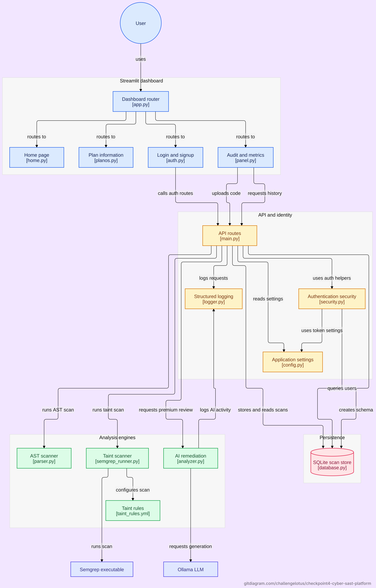

<div align="center">
  
  <h1>🛡️ Motor SAST & DevSecOps (SaaS Edition)</h1>
  <p><em>Análise Estática de Segurança, Rastreamento de Vulnerabilidades e Autenticação</em></p>
  <p>
    
    
    
    
    
    
    
  </p>
  <p>
    <b>Status do Projeto:</b> ✅ Plataforma V4.0 (100% Funcional) | Entrega Final Concluída
  </p>
</div>

---

## 📑 Sumário

- [Descrição do Projeto](#-descrição-do-projeto)
- [Arquitetura do Sistema](#️-arquitetura-do-sistema-c4-model)
- [Principais Funcionalidades](#-principais-funcionalidades)
- [Tecnologias Utilizadas](#️-tecnologias-utilizadas)
- [Como Instalar e Rodar](#-como-instalar-e-rodar-o-projeto)
- [Como Usar](#-como-usar-guia-da-versão-40-saas)
- [Equipe de Desenvolvimento](#-equipe-de-desenvolvimento)
- [Licença e Ética](#-licença-e-ética)

---

## 📝 Descrição do Projeto

A **Plataforma SAST & DevSecOps** é um motor de análise estática de segurança corporativo focado na auditoria de código-fonte Python. A missão do projeto é aplicar a cultura *Shift-Left*, trazendo a segurança para as fases iniciais do ciclo de desenvolvimento de software (SDLC).

A arquitetura moderna (Multi-Page Application) combina:

- ⚡ **Análise estrutural rápida** (AST)
- 🔍 **Rastreamento avançado de fluxo de dados** (Semgrep)
- 🤖 **Inteligência Artificial** (Llama 3) rodando localmente para validação semântica

A plataforma opera em modelo SaaS, com controle de acesso baseado em planos (RBAC), logs estruturados e integração completa com pipelines de CI/CD.

---

## 🏛️ Arquitetura do Sistema (C4 Model)

> O diagrama abaixo ilustra a arquitetura técnica conteinerizada da plataforma, detalhando a comunicação entre o frontend, a API síncrona protegida via JWT, o banco de dados e os múltiplos motores de análise.



---

## ✨ Principais Funcionalidades

| | Funcionalidade | Descrição |
| --- | --- | --- |
| 🔐 | **Autenticação e Segurança da API** | Sessão via tokens JWT, hash seguro (Bcrypt) e isolamento multi-tenant: cada usuário acessa apenas seus próprios dados. |
| 💳 | **Controle de Planos (SaaS)** | Recursos diferenciados entre os planos *Free* e *Premium*. |
| 🌳 | **Parsing Estrutural (AST)** | Converte o código em nós de sintaxe abstrata para detectar segredos (CWE-798) e injeções de código (CWE-94). |
| 🧬 | **Taint Analysis (Semgrep)** | Rastreia o fluxo de dados para identificar falhas complexas. |
| 🧠 | **Análise Semântica (IA Local Premium)** | LLM isolado classifica a severidade real, justifica falsos positivos e gera laudos executivos em PDF. |
| 📡 | **Observabilidade DevSecOps** | Logs estruturados em JSON (Loguru) e credenciais via `.env` (database seeding idempotente). |
| 📊 | **Dashboard Executivo (MPA)** | Telas de landing page, login, auditoria de código, métricas globais e inspeção detalhada do histórico por arquivo. |
| 🚧 | **Security Gates (CI/CD)** | GitHub Actions bloqueia *Pull Requests* inseguros, com cache otimizado e relatórios de auditoria via artefatos. |

---

## 🛠️ Tecnologias Utilizadas

| Componente | Tecnologias |
| --- | --- |
| **Backend & API** | Python 3.11, FastAPI, SQLAlchemy, SQLite, Pydantic, Passlib/Bcrypt |
| **Interface Visual** | Streamlit (Multi-Page), Plotly (gráficos), FPDF2 (relatórios) |
| **Motores de Análise** | Módulo nativo `ast`, Semgrep |
| **Inteligência Artificial** | Ollama rodando localmente com modelo Llama 3 |
| **DevSecOps** | Docker, Docker Compose, GitHub Actions (CI/CD), Loguru |

---

## 🚀 Como Instalar e Rodar o Projeto

Siga os passos abaixo para subir a infraestrutura completa do SAST na sua máquina.

### 📋 Pré-requisitos

- Docker e Docker Compose instalados
- Git

### 🔧 Instalação e Execução

**1. Clone o repositório**

```bash
git clone https://github.com/challengelotus/checkpoint4-cyber-sast-platform.git
cd checkpoint4-cyber-sast-platform
```

**2. Configure os segredos (DevSecOps)**

Crie um arquivo `.env` na raiz, baseado no `.env.example`:

```bash
cp .env.example .env
```

> ⚠️ Edite o `.env` e defina senhas fortes para o JWT e para o Administrador Padrão.

**3. Suba os containers**

```bash
docker compose up --build -d
```

**4. Baixe o modelo de IA (apenas na primeira execução)**

Acesse o shell do container do Ollama e baixe o Llama 3:

```bash
docker exec -it <nome_do_container_ollama> ollama run llama3
```

Digite `/bye` para sair após a conclusão do download.

---

## 💡 Como Usar (Guia da Versão 4.0 SaaS)

1. Acesse o portal em **http://localhost:8501**.
2. Vá até a aba **Login / Cadastro** na barra lateral.
3. Entre com as credenciais de Administrador (Premium) definidas no `.env`, ou crie uma conta **Free**.
4. No **Dashboard SAST**, envie um arquivo Python (`.py`) vulnerável (ex.: arquivos da pasta `tests/`).
5. O sistema valida seu plano e executa a auditoria correspondente:

| Plano | Análise executada |
| --- | --- |
| 🆓 **Free** | AST + Semgrep |
| 💎 **Premium** | AST + Semgrep + IA Llama 3 + laudo em PDF |

6. Abra a aba **📈 Métricas e Histórico do Workspace** para ver gráficos de severidade, o ranking de arquivos críticos e os detalhes técnicos de varreduras anteriores.

---

## 👥 Equipe de Desenvolvimento

Projeto desenvolvido para a disciplina de **Cybersecurity** na Engenharia de Software.

| Integrante | RM | Responsabilidade Principal |
| --- | --- | --- |
| João Victor Soave | RM557595 | Arquiteto de Software e Desenvolvedor Backend |
| Maria Alice Freitas Araújo | RM557516 | QA e Especialista em Testes/Segurança |
| Pedro Henrique Mendes dos Santos | RM555332 | Desenvolvedor Backend / Integração LLM |
| Rafael Teofilo Lucena | RM555600 | Arquiteto de Infraestrutura e Diagramação (C4) |
| Vinícius Fernandes Tavares Bittencourt | RM558909 | Engenheiro DevOps / Docker |

---

## 📄 Licença e Ética

Projeto acadêmico. Este repositório está licenciado sob a **MIT License**.
